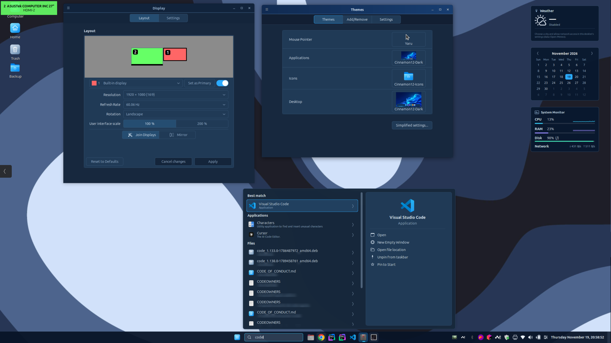

# Cinnamon12 Studio

**E se existisse um Windows 12? Este projeto imagina como ele seria, e faz isso funcionar de verdade no Linux, sobre o desktop Cinnamon.**

Barra de tarefas centralizada, busca integrada ao painel, menu Iniciar novo, configurações rápidas, widgets, ícones e janelas em azul-marinho, nas variantes clara e escura. É tudo tema e applets do Cinnamon: nada de máquina virtual, nada de mockup.



> **Conceito de fã, não oficial.** O Cinnamon12 Studio não tem relação com a Microsoft e não é uma versão do Windows. "Windows" é marca registrada da Microsoft Corporation. Todos os ícones, wallpapers e o código deste projeto são originais; logotipos de aplicativos de terceiros não são copiados.

## Destaques

- **Barra de tarefas de borda a borda**: 48 px, apps no centro, "mostrar área de trabalho" no canto, como no Windows.
- **Busca no painel** (`Cinnamon12 Search`): digite direto no campo da barra e os resultados aparecem acima.
  - Melhor correspondência, aplicativos, configurações, arquivos e pastas da sua pasta pessoal.
  - Painel de ações ao lado: abrir, abrir com outro app, abrir local do arquivo, fixar na barra e no Iniciar, copiar caminho, abrir no terminal.
  - Também pode ficar como ícone de lupa ou só no atalho (Super+F).
  - Tudo local: o índice de nomes é feito num processo separado de baixa prioridade, sem rede.
- **Menu Iniciar** (`Cinnamon12 Start`): busca, categorias, apps fixados, arquivos recentes e botões de sessão.
- **Configurações rápidas** (`Cinnamon12 Quick Settings`): Wi-Fi, Bluetooth, modo escuro, não perturbe, volume, brilho e modo avião, com estados reais do sistema.
- **Widgets**: calendário, monitor do sistema (CPU, RAM, disco, rede) e clima (desligado por padrão, só com sua permissão).
- **Temas Light e Dark** para o shell do Cinnamon, GTK 3 e GTK 4, inclusive barras de título, Nemo e janelas sem foco. Contraste de texto WCAG AA nas duas variantes.
- **Ícones e wallpapers originais**, com 3 papéis de parede em até 4K.
- **Tudo reversível**: nada muda até você ativar, e um comando desfaz.

## Instalação

Testado no **Ubuntu 24.04 LTS com Cinnamon 6.0.4 (X11)**. Outras versões 6.x do Cinnamon devem funcionar, mas não foram testadas.

### Pacote `.deb` (recomendado)

Baixe o `.deb` da [última release](https://github.com/ftxavier/cinnamon12-studio/releases/latest) e instale:

```bash
sudo apt install ./cinnamon12-studio_0.4.0-1_all.deb
```

O pacote só copia arquivos para `/usr/share`. Ele não roda scripts de instalação nem muda a aparência de ninguém. Cada usuário ativa no seu próprio login, sem sudo:

```bash
cinnamon12 apply dark          # ou: cinnamon12 apply light
cinnamon12 panel apply --launcher cinnamon12 --quick-settings --search
cinnamon12 widgets apply       # calendário e monitor; --weather inclui o clima
```

### Sem sudo, direto do repositório

```bash
git clone https://github.com/ftxavier/cinnamon12-studio.git
cd cinnamon12-studio
./cinnamon12 doctor            # confere o ambiente
./cinnamon12 install           # copia temas, ícones e applets para a sua home
./cinnamon12 apply dark
./cinnamon12 panel apply --launcher cinnamon12 --quick-settings --search
```

## Comandos

| Comando | O que faz |
|---|---|
| `cinnamon12 apply light\|dark` | Ativa o tema (shell, GTK, ícones e wallpaper), guardando suas preferências antes |
| `cinnamon12 restore` | Volta as preferências que estavam antes do `apply` |
| `cinnamon12 panel apply [opções]` | Barra de 48 px com menu e janelas no centro, com backup do painel |
| `--launcher cinnamon12` | Troca o menu nativo pelo Cinnamon12 Start |
| `--quick-settings` | Adiciona as configurações rápidas antes do relógio |
| `--search` | Adiciona a busca logo depois do menu |
| `--dry-run` | Mostra o que mudaria, sem aplicar |
| `cinnamon12 panel restore` | Devolve o painel exatamente como estava |
| `cinnamon12 widgets apply [--weather] \| restore` | Coloca ou retira os widgets da lateral |
| `cinnamon12 doctor` | Diagnóstico do ambiente |
| `cinnamon12 uninstall` | Restaura tudo e remove o que a instalação local copiou (instalação sem sudo) |

Ao ativar, reinicie o Cinnamon uma vez (**Ctrl+Alt+Esc**) para ele carregar as imagens novas do tema.

## Desinstalar

```bash
cinnamon12 widgets restore; cinnamon12 panel restore; cinnamon12 restore
sudo apt remove cinnamon12-studio      # se instalou pelo .deb
./cinnamon12 uninstall                  # se instalou sem sudo
```

## Limitações conhecidas

- O Cinnamon não tem desfoque real atrás de painéis e menus; a transparência é só transparência.
- Apps GTK 4 com libadwaita, Qt, Electron e navegadores podem ignorar parte do tema GTK.
- O arranjo de monitores em Configurações > Tela continua cinza: a cor vem do próprio programa e tem prioridade sobre o tema.
- Os applets e widgets são novos; se algo der errado, `cinnamon12 panel restore` e `cinnamon12 widgets restore` desfazem.

## Para desenvolvedores

As cores e raios saem de `design/tokens.json`; o CSS de todos os temas é gerado por scripts:

```bash
python3 scripts/generate-themes.py   # temas Cinnamon, GTK 3 e GTK 4
python3 scripts/validate.py          # checagem estática, inclusive contraste WCAG
python3 scripts/build-deb.py         # gera dist/cinnamon12-studio_<versão>_all.deb
```

`generate-assets.py` (ícones) precisa de Pillow e CairoSVG. Estrutura principal:

```text
themes/        temas Cinnamon12-Light e Cinnamon12-Dark (gerados)
icons/         Cinnamon12-Icons (freedesktop, herda Yaru/Adwaita)
applets/       Start, Search, Quick Settings e Quick Links
desklets/      calendário, monitor do sistema, clima e relógio
assets/        wallpapers, componentes de UI e imagens de divulgação
scripts/       geradores, validação, instalador (manage.py) e build do .deb
docs/          compatibilidade, extras e especificação original
```

Histórico de mudanças em [CHANGELOG.md](CHANGELOG.md). Licença e procedência dos assets em [LICENSE.md](LICENSE.md).
